<p align="center"><a href="README.md">한국어</a> · <a href="README.en.md">English</a> · <b>日本語</b></p>

<p align="center">
  <picture>
    <source media="(prefers-color-scheme: dark)" srcset="assets/banner-dark.svg">
    
  </picture>
</p>

# Music Lens — 音楽分析室

音源からリズム・和音・音符・歌詞・エネルギーの手がかりを取り出し、AI（LLM）が根拠を挙げながら音楽を分析できるように渡すプログラムです。

## これは何？

曲を入れると、「何 BPM か、拍がどこにあるか、どのコードと音がいつ鳴ったか、歌詞の単語が拍のどこにかかるか」を時間とともに整理します。結果は画面で見て原音と照らし合わせられ、JSON・Markdown・「AI 팀 전달문」（AI チームへの引き継ぎ文）として書き出したり、MCP で AI に直接渡したりできます。音楽分析の根拠、作曲の参考、スタイルの読み取り、映像演出のために作りました。

使い方は 2 通りです。

- **Web アプリ**：ブラウザーでファイルを開いて分析します。ブラウザーで分析した音源は外に出ません。
- **MCP サーバー**：サーバーが音源を分析し、接続した AI（例：ChatGPT）が会話の中で結果を読みます。個人のモデル API キーは不要です。サイトの公開とチームとの接続はまだ検証前です。

## 主な機能

- **精密分析**：BPM と拍のグリッド、半分・倍のテンポ候補、低・中・高の帯域のアタック、コード・調の候補、複数の音の開始・終了・音高、エネルギーの変化
- **ソロボーカルの音符（任意）**：伴奏のない歌に合わせた SOME モデルで、音符と連続した音高を取り出します。
- **歌詞の単語の書き起こし（任意）**：Whisper で単語ごとの開始・終了時刻を推定し、近い拍と同じ時刻の音・コードを探します。
- **原音との照合**：ピアノロール、単語・変化区間のクリック、原音の再生と移動
- **AI に渡す**：JSON、Markdown の要約、「AI 팀 전달문」、MCP ツール
- **サーバーの分析ツール（MCP）**：拍・BPM、波形のダイナミクス、スペクトルの質感、拍に対するアタック、分離したボーカルの音高、曲全体の転換候補、複数の区間をつないだ時間軸
- **保存と読み込み**：ログインしたユーザーごとの保管庫（UTF-8 JSON で 1.9MB まで）。音源は保存しません。
- **Mac の分析サーバー（`lan/`）**：同じルーターにつながった AI チームのメンバーが、署名付きのリクエストで Mac の分析機能を使えるようにする別のサーバー

## クイックスタート

Windows では、このフォルダーの `Start-MusicLens.cmd` を実行して `http://127.0.0.1:5173/` を開きます。起動したターミナルで Ctrl+C を押すと止まります。

最初の準備には、Node.js 22.13 以上と、リポジトリにアクセスできる GitHub アカウントが必要です。

```sh
git clone https://github.com/Song-Seng-Hun/llm_music_lens.git
cd llm_music_lens
npm run install:ci
npm run build
npm run db:local
npm run dev -- --host 127.0.0.1
```

画面が開いたらファイルを選び、**정밀 분석 시작**（精密分析を開始）を押します。ファイルがなければ、16 秒の合成デモで先に試せます。

## 使用例

### 曲を 1 つ分析して AI に渡す

1. ファイルを選んで精密分析を始めます。歌詞が必要なら Whisper のモデルと言語を選びます。
2. ピアノロールと単語をクリックして、原音と合っているか確かめます。
3. 「AI 팀 전달문」か JSON を書き出して、AI との会話に渡します。画面の要約と引き継ぎ文は、JSON 全体の代わりにはなりません。

### AI がサーバーで直接分析する（MCP）

サイトを公開して AI に接続すると、AI が会話の途中でこれらのツールを呼び出します。

| MCP ツール | すること |
|---|---|
| `analyze_music_timing` | 1〜30 秒の PCM の拍・小節の頭・BPM、波形、スペクトルの質感、アタック、（分離したボーカルなら）音高 |
| `analyze_music_structure` | 10 分までの曲で、区間の転換候補と音量・音色の変化 |
| `compose_music_timeline` | 分析した複数の区間の拍と音高を、曲全体の時間でつなぐ |
| `list_music_reports` / `get_music_report` / `get_music_timeline` | 保存した分析結果の一覧、要約、時間範囲ごとの詳細 |

## 現在の状態と限界

- 入力ファイルは 12MiB・10 分までで、ブラウザーがデコードできる MP3/WAV/FLAC/OGG/M4A/AAC/WEBM です。
- すべての結果は `accuracy: unvalidated` です。合成音や公開音声、数曲での測定は、実際の曲全般の精度を意味しません。
- 音符には伴奏・倍音・誤検出が混ざることがあり、実際の楽譜ではありません。コードと調は根拠が足りなければ保留します。
- 歌詞の書き起こしは、歌・速いラップ・複数の声で単語をでっち上げたり落としたりすることがあります。
- 楽器・ジャンル・感情は自動では判断しません。スタイルの解釈は、出所と時間範囲を挙げる AI の役目です。
- サイトの公開、チームとの接続、ユーザーごとのレポート参照は、実際の認証付き接続ではまだ確認していません。

## もっと見る

詳しい文書は英語です。

- [全体のガイド](docs/guide.md)：サーバーツールごとの説明、ブラウザー分析の手順、MCP での接続、入力と精度の範囲の全体、開発メモ
- [研究の状況と限界](docs/research-status.md)：測定の要約
- サーバーツールの文書：[拍・BPM](docs/server-timing.md) · [波形](docs/waveform-dynamics.md) · [スペクトルの質感](docs/spectral-texture.md) · [拍に対するアタック](docs/attack-beat.md) · [ボーカルの音高](docs/server-vocal-pitch.md) · [曲の構成](docs/music-structure.md) · [時間軸](docs/music-continuity.md)
- [ソロボーカル分析の準備](docs/vocal-specialist.md)
- [Mac の分析サーバー](lan/README.md)
- 開発の確認：`npm run typecheck`、`npm test`、`npm run build`
