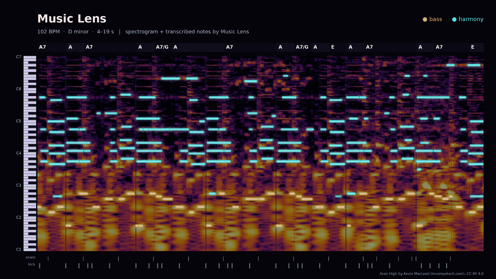

<p align="center"><b>한국어</b> · <a href="docs/README.en.md">English</a> · <a href="docs/README.ja.md">日本語</a></p>

<p align="center">
  <picture>
    <source media="(prefers-color-scheme: dark)" srcset="assets/banner-dark.svg">
    
  </picture>
</p>

# Music Lens — 음악 분석실

음원에서 박자·화음·음표·가사·에너지 단서를 뽑아, AI(LLM)가 근거를 들어 음악을 분석할 수 있게 넘겨 주는 프로그램입니다.

<p align="center"></p>
<p align="center"><sub>Music Lens로 50초 발췌 음원 중 4–19초를 그린 이미지입니다. 음원: <a href="https://www.incompetech.com/music/royalty-free/index.html?isrc=USUAN1100763">“Aces High”</a> by Kevin MacLeod (incompetech.com), <a href="https://creativecommons.org/licenses/by/4.0/">CC BY 4.0</a></sub></p>

## 이게 뭔가요

곡을 넣으면 "몇 BPM인지, 박이 어디에 있는지, 어떤 코드와 음이 언제 울렸는지, 가사 단어가 박의 어디에 걸리는지"를 시간과 함께 정리합니다. 결과는 화면으로 보고 원음과 맞춰 볼 수 있고, JSON이나 Markdown, AI에게 건넬 요약 문서로 내보내거나 MCP로 AI에게 바로 넘길 수 있습니다. 음악 분석의 근거, 작곡 참고, 스타일 읽기, 영상 연출에 쓰려고 만들었습니다.

두 가지 방식으로 씁니다.

- **웹 앱**: 브라우저에서 파일을 열어 분석합니다. 브라우저에서 분석한 음원은 밖으로 나가지 않습니다.
- **MCP 서버**: 서버가 음원을 분석하고, 연결된 AI(예: ChatGPT)가 대화 안에서 결과를 읽습니다. 개인 모델 API 키가 필요 없습니다. 사이트 게시와 AI 연결은 아직 검증 전입니다.

## 주요 기능

### 웹 앱

- **정밀 분석**: BPM과 박 격자, 절반·두 배 템포 후보, 저·중·고 대역 어택, 코드·조성 후보, 여러 음의 시작·끝·음높이, 에너지 변화
- **빠른 신호 분석**: 모델 없이 파형·리듬·음높이 단서만 빠르게 계산합니다.
- **솔로 보컬 음표 (선택)**: 반주 없는 노래용 SOME 모델로 음표와 연속 음높이를 뽑습니다.
- **가사 단어 전사 (선택)**: Whisper로 단어마다 시작·끝 시각을 추정하고, 가까운 박과 같은 시각의 음·코드를 찾아 줍니다.
- **원본 대조**: 피아노 롤, 단어·변화 구간 클릭, 원음 재생과 이동
- **원음 다시 연결**: 저장해 둔 결과에 같은 원음 파일을 다시 붙여 구간을 들어 봅니다. 다른 파일은 받지 않습니다.
- **YouTube 참고 영상**: 공개 영상 주소를 넣으면 결과 옆에서 영상을 열어 볼 수 있습니다. 주소만으로는 분석하지 않습니다.
- **AI에게 넘기기**: JSON, Markdown 요약, AI용 요약 문서, MCP 도구
- **저장과 불러오기**: 로그인한 사용자별 보관함(UTF-8 JSON 1.9 MB까지)과 분석 JSON 파일 불러오기. 음원은 저장하지 않습니다.
- **Mac 로컬 분석 결과 보기**: `local/`에서 내보낸 단어 타이밍과 감정·분위기 결과를 웹 앱에서 엽니다.

### Mac 분석 서버 (`lan/`)

Mac에서 명령줄로 바로 쓰거나, 같은 집 네트워크의 다른 컴퓨터에서 서명된 요청으로 씁니다. 자세한 내용은 [Mac 분석 서버 안내](lan/README.md)에 있습니다.

- **AI가 읽는 악보 요약**: 섹션마다 한 줄인 짧은 요약부터 마디 단위 확대까지 텍스트로 줍니다.
- **빠른 첫 분석**: 파트를 나누지 않고 박·코드·조성·섹션·멜로디를 먼저 봅니다.
- **파트별 편곡 읽기 (선택)**: 보컬·베이스·드럼을 분리해 음과 타격을 읽고, 반주 음표와 코드, 곡의 섹션을 함께 줍니다. 섹션마다 어느 파트가 켜져 있는지도 알려 줘서 편곡이 어떻게 쌓이는지 볼 수 있습니다.
- **노래 음표 (선택)**: 분리한 보컬에서 부른 음을 음표로 읽습니다.
- **마디와 리듬 (선택)**: 마디 첫박, 마디당 박 수, 마디별 코드와 음계·도수, 한 마디 안의 두 코드, 스윙 여부
- **믹스와 음색 (선택)**: 음량, 스테레오 폭과 좌우 위치, 파트별 위치와 음색
- **가사 반복과 곡 개요**: 가사가 되풀이되는 구간(후렴 후보)과, 이를 뼈대로 곡을 순서대로 나눈 개요
- **장르 추정 (선택)**: 곡 전체와 30초 구간마다 Discogs 기준 세부 장르(예: Pop---J-pop)와 큰 갈래(Pop, Rock 등)를 점수와 함께 추정합니다.
- **눈으로 확인하기**: 섹션별 스펙트로그램·피아노 롤 이미지(의심 음표 표시 선택), 보여 주기용 포스터, 원음과 함께 재생되는 HTML 페이지
- **귀로 확인하기**: 왼쪽 귀에는 원음, 오른쪽 귀에는 결과를 합성한 소리를 담은 확인용 파일

### Mac 로컬 분석 (`local/`)

자세한 내용은 [로컬 분석 안내](local/README.md)에 있습니다.

- **단어 타이밍**: Whisper large-v3로 노래 가사의 단어마다 시작·끝 시각을 찾습니다.
- **목소리 감정·음악 분위기 (선택)**: 짧은 구간마다 가수 목소리의 감정이나 음악의 분위기를 점수로 매깁니다.

## 빠른 시작

Windows에서는 이 폴더의 `Start-MusicLens.cmd`를 실행하고 `http://127.0.0.1:5173/`을 엽니다. macOS와 Linux에서는 `web` 폴더에서 아래 두 줄을 실행합니다. 어느 쪽이든 실행한 터미널에서 Ctrl+C를 누르면 멈춥니다.

```sh
npm run db:local
npm run dev -- --host 127.0.0.1
```

처음 준비할 때는 Node.js 22.13 이상이 필요합니다. 이 저장소는 비공개라서, 접근 권한을 받은 GitHub 계정으로만 내려받을 수 있습니다.

```sh
git clone https://github.com/Song-Seng-Hun/llm_music_lens.git
cd llm_music_lens/web
npm run install:ci
npm run build
npm run db:local
npm run dev -- --host 127.0.0.1
```

화면이 뜨면 파일을 고르고 **정밀 분석 시작**을 누릅니다. 파일이 없으면 16초짜리 합성 데모로 먼저 둘러볼 수 있습니다.

Mac 분석 서버는 따로 준비합니다. 필요한 것과 설치 순서는 [Mac 분석 서버 안내](lan/README.md)에 있습니다.

## 사용 예

### 곡 하나를 분석해서 AI에게 넘기기

1. 파일을 고르고 정밀 분석을 시작합니다. 가사가 필요하면 Whisper 모델과 언어를 고릅니다.
2. 피아노 롤과 단어를 눌러 원음과 맞는지 확인합니다.
3. AI용 요약 문서(화면의 **AI 팀 전달문** 버튼)나 JSON을 내려받아 AI와의 대화에 첨부합니다. 화면 요약과 요약 문서가 전체 JSON을 대신하지는 않습니다.

### 장르 추정 결과 읽기 (Mac 분석 서버)

Mac 분석 서버는 곡 전체와 30초 구간마다 Discogs 기준 세부 장르(`Pop---J-pop`처럼 "큰 갈래---세부 장르")와 큰 갈래를 점수와 함께 줍니다. 요청 방법은 [Mac 분석 서버 안내](lan/README.md#genre)에 있습니다.

- **점수 읽는 법**: 장르마다 따로 매긴 모델 추정이라 합이 1이 아니고 확률도 아닙니다. 숫자 크기보다 순위를 보세요.
- 1등 하나만 보지 말고 상위 3개를 함께 보세요. Pop처럼 경계가 흐린 장르와 30초 구간별 결과는 덜 믿을 만합니다. 측정 결과는 [장르 추정 정확도](docs/genre-accuracy.md)에 있습니다.

### AI가 서버에서 직접 분석하기 (MCP)

사이트를 게시하고 AI에 연결하면, AI가 대화 중에 이 도구들을 부릅니다.

| MCP 도구 | 하는 일 |
|---|---|
| `analyze_music_timing` | 1~30초 PCM의 박·마디 첫박·BPM, 파형, 스펙트럼 질감, 어택, (분리된 보컬이면) 음높이 |
| `analyze_music_structure` | 10분까지의 곡에서 구간 전환 후보와 소리 크기·음색 변화 |
| `compose_music_timeline` | 분석한 여러 구간의 박과 음높이를 곡 전체 시간으로 이어 붙이기 |
| `list_music_reports` / `get_music_report` / `get_music_timeline` | 저장된 분석 결과 목록, 요약, 시간 범위별 상세 |

## 현재 상태와 한계

- 입력 파일은 12 MiB·10분까지이고, 브라우저가 디코딩할 수 있는 MP3/WAV/FLAC/OGG/M4A/AAC/WEBM입니다.
- 모든 결과는 `accuracy: unvalidated`입니다. 합성음과 공개 음성, 몇 곡으로 한 측정은 실곡 전반의 정확도를 뜻하지 않습니다.
- 음표에는 반주·배음·오검출이 섞일 수 있어 실제 악보가 아닙니다. 코드와 조성은 근거가 부족하면 보류합니다.
- 가사 전사는 노래·빠른 랩·여러 목소리에서 단어를 지어내거나 빠뜨릴 수 있습니다.
- 악기·감정은 자동으로 판단하지 않습니다. 장르는 Mac 분석 서버의 리듬 층에서만 모델 추정으로 나오며, 웹 앱과 MCP 사이트 도구에는 없습니다. 스타일 해석은 AI가 맡되, 근거가 된 출처와 시간 범위를 함께 밝혀야 합니다.
- 사이트 게시, AI 연결, 사용자별 보고서 조회는 실제 인증 연결로 아직 확인하지 않았습니다.

## AI와 함께 만든 프로젝트

이 프로젝트는 사람이 방향을 정하고 AI 에이전트들이 함께 만든 결과물입니다. 무엇을 만들지, 어떤 정확도를 목표로 할지, 무엇을 채택할지는 사람이 정했고, 구현·측정·코드 리뷰는 Claude(Anthropic)와 Codex(OpenAI) 에이전트가 나눠 맡았습니다. [측정 기록](lan/docs/evaluation.md)은 이 과정에서 에이전트가 남긴 측정 기록입니다.

## 사용 모델과 라이선스

이 저장소의 자체 코드는 [MIT](LICENSE)입니다. 아래 구성은 각자의 조건을 따릅니다.

| 구성 | 쓰는 곳 | 라이선스 |
|---|---|---|
| [Beat This!](https://github.com/CPJKU/beat_this) small0 (ONNX로 변환해 `web/models/beat-this/`에 포함) | 서버 박·BPM | MIT |
| [Spotify Basic Pitch](https://github.com/spotify/basic-pitch-ts) (모델 포함) | 브라우저 음표 | Apache-2.0 |
| [Whisper](https://huggingface.co/Xenova/whisper-base) (`Xenova/whisper-base`·`whisper-small`, 필요할 때 브라우저가 내려받음) | 가사 단어 전사 (선택) | Apache-2.0 (모델 카드 기준) |
| [SOME](https://github.com/openvpi/SOME) (모델은 따로 준비) | 솔로 보컬 음표 (선택) | 코드 MIT, 모델 CC BY-NC-SA 4.0 |
| [Whisper large-v3](https://huggingface.co/mlx-community/whisper-large-v3-mlx) MLX 변환 (Mac 서버에 따로 설치) | Mac 서버 가사 단어 전사 | MIT |
| [Essentia](https://essentia.upf.edu/)와 TempoCNN 모델 (Mac 서버에 따로 설치) | 선택 리듬 층 | Essentia AGPL-3.0, 모델 조건은 확인 안 됨 |
| Essentia Discogs-EffNet·genre_discogs400 모델 (Mac 서버에 따로 설치) | 선택 리듬 층의 장르 추정 | CC BY-NC-ND 4.0 |
| [BTC](https://github.com/jayg996/BTC-ISMIR19) (Mac 서버에 따로 설치) | 선택 리듬 층의 코드 인식 | MIT |
| [Spotify Basic Pitch](https://github.com/spotify/basic-pitch) (Mac 서버에 따로 설치) | 선택 리듬 층의 베이스 음 시작 | Apache-2.0 |
| [ADTOF](https://github.com/MZehren/ADTOF) 가중치 (Mac 서버에 따로 설치) | 선택 리듬 층의 드럼 타격 | CC BY-NC-SA 4.0 |
| Transformers.js · ONNX Runtime Web · TensorFlow.js | 브라우저에서 모델 실행 | Apache-2.0 · MIT · Apache-2.0 |

- SOME 모델(CC BY-NC-SA 4.0), Discogs 장르 모델(CC BY-NC-ND 4.0), ADTOF 가중치(CC BY-NC-SA 4.0)에는 비상업적 이용 조건이 있습니다.
- ADTOF 가중치는 상용 음악에 맞춘 리듬 게임 채보로 학습됐고, 이 저장소에는 포함되지 않습니다.
- 포함된 구성의 라이선스 원문은 [web/public/licenses/](web/public/licenses/README.md)와 [web/models/beat-this/](web/models/beat-this/README.md)에 있습니다.

## 더 보기

자세한 문서는 영어입니다.

- [전체 안내](docs/guide.md): 서버 도구별 설명, 브라우저 분석 단계, MCP 연결, 입력·정확도 범위 전체, 개발 메모
- [연구 상태와 한계](docs/research-status.md): 측정 요약
- 서버 도구 문서: [박·BPM](docs/server-timing.md) · [파형](docs/waveform-dynamics.md) · [스펙트럼 질감](docs/spectral-texture.md) · [박 대비 어택](docs/attack-beat.md) · [보컬 음높이](docs/server-vocal-pitch.md) · [곡 구조](docs/music-structure.md) · [시간축](docs/music-continuity.md)
- [솔로 보컬 분석 준비](docs/vocal-specialist.md)
- [Mac 분석 서버](lan/README.md)
- [장르 추정 정확도](docs/genre-accuracy.md)
- 개발 확인(`web/`에서): `npm run typecheck`, `npm test`, `npm run build`
