<p align="center"><a href="../README.md">한국어</a> · <b>English</b> · <a href="README.ja.md">日本語</a></p>

<p align="center">
  <picture>
    <source media="(prefers-color-scheme: dark)" srcset="../assets/banner-dark.svg">
    
  </picture>
</p>

# Music Lens — a music analysis room

A program that pulls beat, harmony, note, lyric and energy cues out of audio and hands them to an AI (LLM), so it can analyze music while citing evidence.

## What is it?

Give it a song, and it lays out, along the timeline, the BPM, where the beats are, which chords and notes sounded when, and where each lyric word falls against the beat. You can look at the results on screen and check them against the original audio, export them as JSON, Markdown or a summary note for an AI, or hand them straight to an AI over MCP. It is made for evidence in music analysis, composition references, reading a style and planning video.

There are two ways to use it.

- **Web app**: open a file in the browser and analyze it there. Audio analyzed in the browser never leaves it.
- **MCP server**: the server analyzes the audio and a connected AI (for example ChatGPT) reads the results inside the conversation. No personal model API key is needed. Publishing the site and connecting it to an AI are not yet verified.

## Features

- **Detailed analysis**: BPM and the beat grid, half/double-tempo candidates, low/mid/high attacks, chord and key candidates, the start, end and pitch of polyphonic notes, and energy changes
- **Solo-voice notes (optional)**: the SOME model for unaccompanied singing extracts notes and a continuous pitch curve.
- **Lyric word transcription (optional)**: Whisper estimates when each word starts and ends, and finds the nearest beat and the notes and chords sounding at the same time.
- **Check against the original**: piano roll, clickable words and change regions, playback and seeking in the original audio
- **Hand-off to AI**: JSON, a Markdown summary, a summary note for an AI, and MCP tools
- **Save and import**: a per-user library for signed-in users (up to 1.9 MB of UTF-8 JSON). Audio is not stored.
- **Mac analysis server (`lan/`)**: a separate server that analyzes songs on the Mac and lets other computers on your home network use it through signed requests
- **Reading the arrangement by part (Mac analysis server, optional)**: separates vocals, bass and drums to read their notes and hits, and adds accompaniment notes, chords and the song's sections. Each section also says which parts are on, so you can see how the arrangement builds.
- **Genre estimate (Mac analysis server, optional)**: Discogs styles (e.g. Pop---J-pop) and parent genres (Pop, Rock, ...) with scores, for the whole song and every 30 s window.

## Quick start

On Windows, run `Start-MusicLens.cmd` in the repository folder and open `http://127.0.0.1:5173/`. On macOS and Linux, run these two lines in the `web` folder. Either way, press Ctrl+C in that terminal to stop it.

```sh
npm run db:local
npm run dev -- --host 127.0.0.1
```

For a first setup you need Node.js 22.13 or later. The repository is private: you can clone it only with a GitHub account that has been given access.

```sh
git clone https://github.com/Song-Seng-Hun/llm_music_lens.git
cd llm_music_lens/web
npm run install:ci
npm run build
npm run db:local
npm run dev -- --host 127.0.0.1
```

When the page opens, choose a file and press **정밀 분석 시작** (start detailed analysis). With no file, a 16-second synthetic demo lets you look around first.

The Mac analysis server is set up separately. What it needs and how to install it: [Mac analysis server](../lan/README.md).

## Examples

### Analyze a song and hand it to an AI

1. Choose a file and start detailed analysis. For lyrics, pick a Whisper model and a language.
2. Click the piano roll and words to check them against the original audio.
3. Download the summary note (the **AI 팀 전달문** button) or the JSON and attach it to your conversation with the AI. The on-screen summary and the note do not replace the full JSON.

### Reading the genre estimate (Mac analysis server)

The Mac analysis server scores Discogs styles (written "Parent---Style", e.g. `Pop---J-pop`) and parent genres for the whole song and for every 30 seconds. How to ask for them: [Mac analysis server](../lan/README.md#genre).

- **Reading the scores**: each genre is scored on its own, so the scores do not add up to 1 and are not probabilities. Read the ranking, not the number.
- Look at the top 3 together, not only the first. Genres with blurry edges such as Pop, and per-window results, are less reliable. Measurements: [Genre estimate accuracy](genre-accuracy.md).

### Let an AI analyze on the server (MCP)

Once the site is published and connected to an AI, the AI calls these tools during the conversation.

| MCP tool | What it does |
|---|---|
| `analyze_music_timing` | For 1–30 s of PCM: beats, downbeats, BPM, waveform, spectral texture, attacks and, for an isolated vocal, pitch |
| `analyze_music_structure` | Transition candidates and loudness/timbre change over a song of up to 10 minutes |
| `compose_music_timeline` | Joins the beats and pitch of several analyzed segments in whole-song time |
| `list_music_reports` / `get_music_report` / `get_music_timeline` | List, summary and per-time-range detail of saved analyses |

## Status and limits

- Input files go up to 12 MiB and 10 minutes, in whichever of MP3/WAV/FLAC/OGG/M4A/AAC/WEBM the browser decodes.
- Every result is `accuracy: unvalidated`. Measurements on synthetic audio, public speech and a few songs do not stand for accuracy on real songs in general.
- Notes can include accompaniment, overtones and false detections, so they are not a real score. Chords and keys are withheld when the evidence is thin.
- Lyric transcription can make up or miss words in singing, fast rap and multiple voices.
- Instruments and emotion are not decided automatically. Genre comes only as a model estimate from the Mac analysis server's rhythm layer, not from the web app or the site's MCP tools. Reading the style is up to the AI, which should name the sources and time ranges it relies on.
- Publishing the site, connecting it to an AI, and per-user report access have not yet been confirmed over a real authenticated connection.

## Models and licenses

The repository's own code is [MIT](../LICENSE). The components below follow their own terms.

| Component | Used for | License |
|---|---|---|
| [Beat This!](https://github.com/CPJKU/beat_this) small0 (converted to ONNX, included in `web/models/beat-this/`) | Server beats and BPM | MIT |
| [Spotify Basic Pitch](https://github.com/spotify/basic-pitch-ts) (with its model) | Notes in the browser | Apache-2.0 |
| [Whisper](https://huggingface.co/Xenova/whisper-base) (`Xenova/whisper-base` or `whisper-small`, downloaded by the browser when needed) | Lyric word transcription (optional) | Apache-2.0 (per the model card) |
| [SOME](https://github.com/openvpi/SOME) (model prepared separately) | Solo-voice notes (optional) | Code MIT, model CC BY-NC-SA 4.0 |
| [Whisper large-v3](https://huggingface.co/mlx-community/whisper-large-v3-mlx) MLX conversion (installed separately on the Mac server) | Lyric word transcription on the Mac server | MIT |
| [Essentia](https://essentia.upf.edu/) and a TempoCNN model (installed separately on the Mac server) | Optional rhythm layer | Essentia AGPL-3.0; model terms not verified |
| Essentia Discogs-EffNet and genre_discogs400 models (installed separately on the Mac server) | Genre estimate in the optional rhythm layer | CC BY-NC-ND 4.0 |
| [BTC](https://github.com/jayg996/BTC-ISMIR19) (installed separately on the Mac server) | Chord recognition in the optional rhythm layer | MIT |
| [Spotify Basic Pitch](https://github.com/spotify/basic-pitch) (installed separately on the Mac server) | Bass note onsets in the optional rhythm layer | Apache-2.0 |
| [ADTOF](https://github.com/MZehren/ADTOF) weights (installed separately on the Mac server) | Drum hits in the optional rhythm layer | CC BY-NC-SA 4.0 |
| Transformers.js · ONNX Runtime Web · TensorFlow.js | Running models in the browser | Apache-2.0 · MIT · Apache-2.0 |

- The SOME model (CC BY-NC-SA 4.0), the Discogs genre models (CC BY-NC-ND 4.0) and the ADTOF weights (CC BY-NC-SA 4.0) may only be used non-commercially.
- The ADTOF weights were trained on rhythm-game charts made for commercial music, and are not included in this repository.
- License texts for the included components are in [web/public/licenses/](../web/public/licenses/README.md) and [web/models/beat-this/](../web/models/beat-this/README.md).

## More

- [Full guide](guide.md): each server tool, the browser analysis steps, connecting over MCP, the full scope of input and accuracy, and development notes
- [Research status and limits](research-status.md): a summary of measurements
- Server tool docs: [beat and BPM](server-timing.md) · [waveform](waveform-dynamics.md) · [spectral texture](spectral-texture.md) · [attacks against the beat](attack-beat.md) · [vocal pitch](server-vocal-pitch.md) · [song structure](music-structure.md) · [timeline](music-continuity.md)
- [Preparing solo-voice analysis](vocal-specialist.md)
- [Mac analysis server](../lan/README.md)
- [Genre estimate accuracy](genre-accuracy.md)
- Development checks (in `web/`): `npm run typecheck`, `npm test`, `npm run build`
