<p align="center"><a href="../README.md">한국어</a> · <a href="README.en.md">English</a> · <b>日本語</b></p>

<p align="center">
  <picture>
    <source media="(prefers-color-scheme: dark)" srcset="../assets/banner-dark.svg">
    
  </picture>
</p>

# Music Lens — 音楽分析室

音源からリズム・和音・音符・歌詞・エネルギーの手がかりを取り出し、AI（LLM）が根拠を挙げながら音楽を分析できるように渡すプログラムです。

## これは何？

曲を入れると、「何 BPM か、拍がどこにあるか、どのコードと音がいつ鳴ったか、歌詞の単語が拍のどこにかかるか」を時間とともに整理します。結果は画面で見て原音と照らし合わせられ、JSON や Markdown、AI に渡すための要約メモとして書き出したり、MCP で AI に直接渡したりできます。音楽分析の根拠、作曲の参考、スタイルの読み取り、映像演出のために作りました。

使い方は 2 通りです。

- **Web アプリ**：ブラウザーでファイルを開いて分析します。ブラウザーで分析した音源は外に出ません。
- **MCP サーバー**：サーバーが音源を分析し、接続した AI（例：ChatGPT）が会話の中で結果を読みます。個人のモデル API キーは不要です。サイトの公開と AI との接続は、まだ検証していません。

## 主な機能

- **精密分析**：BPM と拍のグリッド、半分・倍のテンポ候補、低・中・高の帯域のアタック、コード・調の候補、複数の音の開始・終了・音高、エネルギーの変化
- **ソロボーカルの音符（任意）**：伴奏のない歌向けの SOME モデルで、音符と連続した音高を取り出します。
- **歌詞の単語の書き起こし（任意）**：Whisper で単語ごとの開始・終了時刻を推定し、近い拍と同じ時刻の音・コードを探します。
- **原音との照合**：ピアノロール、単語・変化区間のクリック、原音の再生と移動
- **AI に渡す**：JSON、Markdown の要約、AI 向けの要約メモ、MCP ツール
- **保存と読み込み**：ログインしたユーザーごとの保管庫（UTF-8 JSON で 1.9 MB まで）。音源は保存しません。
- **Mac の分析サーバー（`lan/`）**：Mac で曲を分析し、同じ家庭内ネットワークのほかのパソコンからも署名付きのリクエストで使えるようにする別のサーバー
- **パート別の編曲の読み取り（Mac 分析サーバー、任意）**：ボーカル・ベース・ドラムを分離して音と打点を読み、伴奏の音符、コード、曲のセクションも返します。セクションごとにどのパートが鳴っているかも分かるので、編曲の積み上げ方を確認できます。
- **ジャンル推定（Mac 分析サーバー、任意）**：曲全体と 30 秒区間ごとに、Discogs のスタイル（例：Pop---J-pop）と大分類（Pop、Rock など）をスコア付きで推定します。

## クイックスタート

Windows では、リポジトリのフォルダーにある `Start-MusicLens.cmd` を実行して `http://127.0.0.1:5173/` を開きます。macOS と Linux では、`web` フォルダーで次の 2 行を実行します。どちらの場合も、起動したターミナルで Ctrl+C を押すと止まります。

```sh
npm run db:local
npm run dev -- --host 127.0.0.1
```

最初の準備には Node.js 22.13 以上が必要です。このリポジトリは非公開なので、アクセス権をもらった GitHub アカウントでないとクローンできません。

```sh
git clone https://github.com/Song-Seng-Hun/llm_music_lens.git
cd llm_music_lens/web
npm run install:ci
npm run build
npm run db:local
npm run dev -- --host 127.0.0.1
```

画面が開いたらファイルを選び、**정밀 분석 시작**（精密分析を開始）を押します。ファイルがなければ、16 秒の合成デモで先に試せます。

Mac の分析サーバーは別に準備します。必要なものとインストール手順は [Mac の分析サーバー](../lan/README.md) にあります。

## 使用例

### 曲を 1 つ分析して AI に渡す

1. ファイルを選んで精密分析を始めます。歌詞が必要なら Whisper のモデルと言語を選びます。
2. ピアノロールと単語をクリックして、原音と合っているか確かめます。
3. 要約メモ（画面の **AI 팀 전달문** ボタン）か JSON をダウンロードして、AI との会話に添付します。画面の要約や要約メモは、JSON 全体の代わりにはなりません。

### ジャンル推定の読み方（Mac 分析サーバー）

Mac 分析サーバーは、曲全体と 30 秒ごとに、Discogs のスタイル（`Pop---J-pop` のように「大分類---スタイル」）と大分類をスコア付きで返します。頼み方は [Mac の分析サーバー](../lan/README.md#genre) にあります。

- **スコアの読み方**：ジャンルごとに別々に付けたモデル推定なので、合計は 1 にならず、確率でもありません。数値より順位を見てください。
- 1 位だけでなく、上位 3 件をまとめて見てください。Pop のように境界があいまいなジャンルや 30 秒区間ごとの結果は信頼度が下がります。測定結果は [ジャンル推定の精度](genre-accuracy.md) にあります。

### AI がサーバーで直接分析する（MCP）

サイトを公開して AI に接続すると、AI が会話の途中でこれらのツールを呼び出します。

| MCP ツール | すること |
|---|---|
| `analyze_music_timing` | 1〜30 秒の PCM の拍・小節の頭・BPM、波形、スペクトルの質感、アタック、（分離したボーカルなら）音高 |
| `analyze_music_structure` | 10 分までの曲で、区間の転換候補と音量・音色の変化 |
| `compose_music_timeline` | 分析した複数の区間の拍と音高を、曲全体の時間でつなぐ |
| `list_music_reports` / `get_music_report` / `get_music_timeline` | 保存した分析結果の一覧、要約、時間範囲ごとの詳細 |

## 現在の状態と限界

- 入力ファイルは 12 MiB・10 分までで、ブラウザーがデコードできる MP3/WAV/FLAC/OGG/M4A/AAC/WEBM です。
- すべての結果は `accuracy: unvalidated` です。合成音や公開音声、数曲での測定は、実際の曲全般の精度を意味しません。
- 音符には伴奏・倍音・誤検出が混ざることがあり、実際の楽譜ではありません。コードと調は根拠が足りなければ保留します。
- 歌詞の書き起こしは、歌・速いラップ・複数の声で存在しない単語を出したり、単語を落としたりすることがあります。
- 楽器・感情は自動では判断しません。ジャンルは Mac 分析サーバーのリズム層でのみモデル推定として出し、Web アプリとサイトの MCP ツールにはありません。スタイルの解釈は AI に任せますが、そのときは根拠にした出所と時間範囲を示してもらいます。
- サイトの公開、AI との接続、ユーザーごとのレポート参照は、実際の認証付き接続ではまだ確認していません。

## 使用モデルとライセンス

このリポジトリ独自のコードは [MIT](../LICENSE) です。以下の構成は、それぞれの条件に従います。

| 構成 | 使う場所 | ライセンス |
|---|---|---|
| [Beat This!](https://github.com/CPJKU/beat_this) small0（ONNX に変換して `web/models/beat-this/` に同梱） | サーバーの拍・BPM | MIT |
| [Spotify Basic Pitch](https://github.com/spotify/basic-pitch-ts)（モデル同梱） | ブラウザーの音符 | Apache-2.0 |
| [Whisper](https://huggingface.co/Xenova/whisper-base)（`Xenova/whisper-base`・`whisper-small`、必要なときにブラウザーがダウンロード） | 歌詞の単語の書き起こし（任意） | Apache-2.0（モデルカードによる） |
| [SOME](https://github.com/openvpi/SOME)（モデルは別途用意） | ソロボーカルの音符（任意） | コード MIT、モデル CC BY-NC-SA 4.0 |
| [Whisper large-v3](https://huggingface.co/mlx-community/whisper-large-v3-mlx) MLX 変換版（Mac サーバーに別途インストール） | Mac サーバーの歌詞単語書き起こし | MIT |
| [Essentia](https://essentia.upf.edu/) と TempoCNN モデル（Mac サーバーに別途インストール） | 任意のリズム層 | Essentia AGPL-3.0、モデルの条件は未確認 |
| Essentia Discogs-EffNet・genre_discogs400 モデル（Mac サーバーに別途インストール） | 任意のリズム層のジャンル推定 | CC BY-NC-ND 4.0 |
| [BTC](https://github.com/jayg996/BTC-ISMIR19)（Mac サーバーに別途インストール） | 任意のリズム層のコード認識 | MIT |
| [Spotify Basic Pitch](https://github.com/spotify/basic-pitch)（Mac サーバーに別途インストール） | 任意のリズム層のベース音の立ち上がり | Apache-2.0 |
| [ADTOF](https://github.com/MZehren/ADTOF) の重み（Mac サーバーに別途インストール） | 任意のリズム層のドラムの打点 | CC BY-NC-SA 4.0 |
| Transformers.js・ONNX Runtime Web・TensorFlow.js | ブラウザーでのモデル実行 | Apache-2.0・MIT・Apache-2.0 |

- SOME モデル（CC BY-NC-SA 4.0）、Discogs ジャンルモデル（CC BY-NC-ND 4.0）、ADTOF の重み（CC BY-NC-SA 4.0）には非商用の条件があります。
- ADTOF の重みは、商用楽曲向けに作られたリズムゲームの譜面で学習されています。このリポジトリには含まれません。
- 同梱した構成のライセンス原文は [web/public/licenses/](../web/public/licenses/README.md) と [web/models/beat-this/](../web/models/beat-this/README.md) にあります。

## もっと見る

詳しい文書は英語です。

- [全体のガイド](guide.md)：サーバーツールごとの説明、ブラウザー分析の手順、MCP での接続、入力と精度の範囲の全体、開発メモ
- [研究の状況と限界](research-status.md)：測定の要約
- サーバーツールの文書：[拍・BPM](server-timing.md) · [波形](waveform-dynamics.md) · [スペクトルの質感](spectral-texture.md) · [拍に対するアタック](attack-beat.md) · [ボーカルの音高](server-vocal-pitch.md) · [曲の構成](music-structure.md) · [時間軸](music-continuity.md)
- [ソロボーカル分析の準備](vocal-specialist.md)
- [Mac の分析サーバー](../lan/README.md)
- [ジャンル推定の精度](genre-accuracy.md)
- 開発の確認（`web/` で）：`npm run typecheck`、`npm test`、`npm run build`
