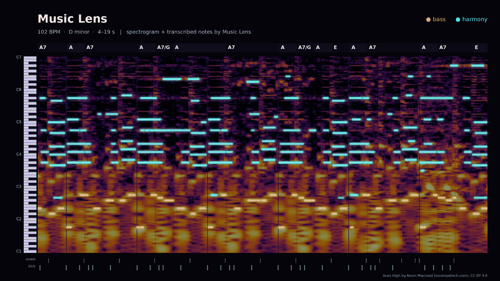

# Music Lens Mac server

The Mac analysis server listens to a song and writes down what it hears: tempo and beats, key, chords, sections,
melody and, with optional models, bass, drums, sung notes and genre. You get the result as a short text sheet that you or
an AI can read section by section, and you can check it against the audio as an image, a scrolling web page or an
ear-check file.

You can use it in two ways:

- **On the Mac itself**, with the local command-line tool `local_cli.py`. Nothing goes over the network.
- **From other computers on your home network**, through a small HTTPS server with signed requests. This needs the
  [setup](docs/setup.md) steps and a compatible client.

The server never loads a model itself: models load only inside each analysis job.

## What you need

- A Mac with `/usr/bin/python3` (Python 3.9); the server uses only the standard library.
- Music Lens local and its `ml` wrapper (`~/tools/music-lens/ml`); see [local/README.md](../local/README.md).
- A config file, `~/.music-lens/api.json`. The local tool reads the same config as the server, so do steps 1-4 of
  [setup](docs/setup.md) first. For use on the Mac alone you can skip the firewall and the LaunchAgent.
- For beats, chords and the sheet: the rhythm layer turned on ([setup](docs/setup.md#turn-on-the-rhythm-layer)).

## First look at a song

Run from this `lan/` folder. `--quick` skips stem separation, so it takes seconds rather than minutes:

```sh
/usr/bin/python3 -I local_cli.py analyze /abs/song.m4a --language ko --quick
/usr/bin/python3 -I local_cli.py sheet <result_id> --view brief
```

This is the poster view of one result (`sheet <result_id> --png DIR --audio FILE --style poster --start 4 --end 19`):



<sub>Music Lens visualization of 4–19 s of a 50 s excerpt. Music: <a href="https://www.incompetech.com/music/royalty-free/index.html?isrc=USUAN1100763">“Aces High”</a> by Kevin MacLeod (incompetech.com), <a href="https://creativecommons.org/licenses/by/4.0/">CC BY 4.0</a></sub>

In the commands above, the first prints a summary with the `result_id` and the second prints one line per section: its label and role,
times, bars, key and level. From there:

```sh
/usr/bin/python3 -I local_cli.py sheet <result_id>                                   # every section in detail
/usr/bin/python3 -I local_cli.py sheet <result_id> --start 60 --end 90               # bar by bar, at most 30 s
/usr/bin/python3 -I local_cli.py sheet <result_id> --layers chords,drums             # only those details
/usr/bin/python3 -I local_cli.py timeline <result_id> --layer chords --start 30 --end 60 --limit 50   # exact rows
```

Give an AI the sheet first and let it ask for exact rows with `timeline`.

`report <result_id>` also gives an overview: the song cut into parts in order, built on the lyric repeats when
there are any, with each part's loudness, main chords and melody range.

## Quick or full analysis

- **Quick** (`--quick`): beats, tempo, key, chords, energy, genre, lyric repeats, sections and a melody read from the
  full mix. About 5 s on top of speech recognition for a 3.5-minute song. Use it for a first pass.
- **Full** (leave out `--quick`): also separates the song into vocals, bass, drums and the rest, and reads each part:
  bass notes, drum hits, sung notes, which parts play in each section, bars and downbeats, swing, mix and tone. These
  need the optional models, and a full run takes a couple of minutes per song. Run it in the background or with a long
  command timeout.

A later full run replaces a quick result; a quick run never replaces a full one. Quick chord labels match a full run's, without bass slashes or two chords in a bar.
For instrumental audio, add `--emotion-mode music` so speech recognition does not run twice.

Memory, time and disk, measured on one Mac: [Memory and time](../docs/performance.md).

## Check the result against the audio

The server keeps no audio, so each of these needs the audio again. **Use the original audio file.** The renderer checks
that its length matches the analysed audio within 0.5 seconds, and cannot tell apart two files of the same length.

Before the first image, check that:

1. the rhythm layer is on,
2. `rhythm.roll_python` names a python with numpy and matplotlib (and Pillow for the web page)
   ([setup](docs/setup.md#sheet-png-and-html-roll_python)),
3. `roll.py`, `view.py` and `view.html` sit next to `server.py`,
4. the output folder already exists. Existing files are never overwritten.

```sh
/usr/bin/python3 -I local_cli.py sheet <result_id> --png ~/Pictures/roll --audio song.wav            # one image per section
/usr/bin/python3 -I local_cli.py sheet <result_id> --png ~/Pictures/roll --audio song.wav --marks    # with suspect notes and missed energy marked
/usr/bin/python3 -I local_cli.py sheet <result_id> --png ~/Pictures/roll --audio song.wav --style poster --start 40 --end 60 --title "My take"
```

Each image shows the spectrogram with the detected notes outlined over it, the piano roll by part, chords, bar lines
and drum hits. A note outline with no matching line in the spectrogram is worth a second listen. Marks are rules of
thumb that say "look here"; they do not measure accuracy.

For the whole song as one offline web page that plays the audio, with a playhead, zoom and part toggles:

```sh
/usr/bin/python3 -I local_cli.py sheet <result_id> --html ~/Pictures/roll --audio song.m4a --marks
```

The HTML embeds the original audio. Share it only where you can share that audio.

To hear the result, make an ear-check file: the original plays in your left ear and a synth replay of the result in
your right, at the same loudness (at most 60 s; needs a python with numpy):

```sh
python -I ear_check.py RESULT.json SOURCE.wav 60 85 check.wav
```

`RESULT.json` is the stored file `<root>/results-rhythm/<result_id>.json`. Details: [API reference](docs/api-reference.md#ear-check).

## Genre

Any rhythm analysis (`rhythm=1` or `rhythm=quick` over the network, `analyze` locally) adds `genre` to the result when the
Discogs genre models are installed:

- **Whole song**: the top 5 Discogs styles, written "Parent---Style" (for example `Pop---J-pop`), and the top 5 parent
  genres (Pop, Rock, Electronic and so on).
- **Every 30 seconds**: the top 3 styles of each window, from `timeline <result_id> --layer genre` (`layer=genre` over
  the network).
- **Reading the scores**: each style is scored on its own, so the scores do not add up to 1 and are not probabilities.
  Read the ranking, and look at the top three together. Per-window results are less reliable than the whole song.

How it was measured: [genre estimate accuracy](../docs/genre-accuracy.md).

## Use it from another computer

After [setup](docs/setup.md), a client on another computer sends the same requests over HTTPS:
`POST /analyze` with the audio (add `rhythm=quick` or `rhythm=1`), then `GET /sheet/<id>?view=brief`, and
`/timeline`, `/report` and `/earcheck` as above.

If an analysis response is lost, check its receipt (`GET /receipt/<operation id>`). Never resubmit the analysis automatically: it may
already be running.

Routes, parameters and error codes are in the [API reference](docs/api-reference.md).

## Limits

- Every value is an estimate. Chords, notes and sections are a reference to check by ear, not a transcription.
- Tempo can come out at half or double; `bpm_alternatives` lists both. Compare with a published tempo or your own ears.
- A missed downbeat can shift every later bar.
- Lyric repeats come from speech recognition, not verified lyrics: a misheard chorus breaks a repeat, and a line
  hallucinated over an instrumental can create one. A repeat is a chorus candidate, not a confirmed chorus.
- Genre is an estimate of a Discogs release tag, not the song's own genre.
- How each layer was measured, and on what, is in [analysis layers](docs/evaluation.md).

## Models and licences

The optional models are installed separately and are not part of this repository. Several limit how you may use them:

- **Non-commercial only:** the ADTOF drum checkpoint (CC BY-NC-SA 4.0), the Discogs genre models (CC BY-NC-ND 4.0) and
  madmom's data and model files (CC BY-NC-SA). Sources disagree on the All-In-One section checkpoints; one lists them as
  CC BY-NC-SA.
- **Research use:** the Demucs `htdemucs_ft` weights, according to the Demucs maintainer.
- **Terms unconfirmed:** the RMVPE weights and the TempoCNN model.
- BTC (MIT), Basic Pitch (Apache-2.0) and YourMT3+ (Apache-2.0 per its Space card) are permissive.

Read each model's licence table in [analysis layers](docs/evaluation.md) before you install it. The repository's own code
is MIT ([LICENSE](../LICENSE)).

## More

- [Setup](docs/setup.md): install the server, turn on the rhythm layer and optional models, signing
- [API reference](docs/api-reference.md): every route, parameter, field and cache rule
- [Analysis layers](docs/evaluation.md): how each layer works, what it returns, and how it was evaluated
- [Operations](docs/operations.md): files on disk, stopping, crash recovery
- [Contributor notes](docs/contributing.md): files in this folder and how to run the tests
- [Sheet question test](docs/sheet-eval.md)
